# OpenFold3 Quickstart

Run [OpenFold3](https://github.com/aqlaboratory/openfold-3) inference and training, and watch
the training curve.

**[→ Open `quickstart.ipynb`](quickstart.ipynb)**: the single-GPU path, executed, with outputs
kept so you can read them without a GPU.

| Stage | Inference | Training |
|---|---|---|
| One GPU | documented, executed | documented, executed |
| Multiple GPUs, one node | to follow | to follow |
| Multiple nodes (Slurm) | to follow | to follow |

Everything here is a smoke-test-sized run: a small subset of the PDB, a few minutes, enough to
confirm the pipeline works end to end and to see losses being logged. The settings to turn it
into a real run are called out as you go.

Inference is worked through three kinds of input (a single protein, a protein with a ligand,
and a multi-chain complex), each scored against its crystal structure, because the confidence
metrics worth reading differ in each case.

Needs [pixi](https://pixi.sh) 0.80+, a CUDA GPU, and roughly 25 GB free, most of it the pixi
environment and the model parameters.

## Install

```bash
git clone https://github.com/aqlaboratory/openfold-3.git
cd openfold-3

# ~14 GB environment
pixi install -e openfold3-cuda12

# model parameters -> ~/.openfold3/ (~4.3 GB); idempotent
pixi run -e openfold3-cuda12 setup_openfold --non-interactive
```

Check it worked:

```bash
pixi run -e openfold3-cuda12 python -c "import torch; print(torch.cuda.get_device_name(0))"
```

## Inference

### On one GPU

Predict a structure from sequence. The repo ships example queries; ubiquitin is the smallest
at 76 residues.

```bash
pixi run -e openfold3-cuda12 run_openfold predict \
    --query-json examples/example_inference_inputs/query_ubiquitin.json \
    --use-msa-server true \
    --output-dir ./quickstart_inference
```

`--use-msa-server true` uses the public ColabFold server, so this step needs outbound network
and is subject to their rate limits.

Results land under the `--output-dir` you passed, in a directory named after the query key and
the seed:

```
quickstart_inference/
├── ubiquitin/seed_42/              ← query key / seed
│   ├── ..._sample_1_model.cif                      the structure
│   ├── ..._sample_1_confidences.json               full arrays
│   ├── ..._sample_1_confidences_aggregated.json    summary -- rank on this
│   ├── ...                                         (×5 samples)
│   └── timing.json
├── msas/                           alignments fetched from ColabFold
├── summary.txt                     queries succeeded / failed
├── model_config.json               fully-resolved config
└── openfold3_intermediates/
```

The structure module is a diffusion model, so one run produces **five alternative structures**
rather than one. Per sample:

| File | Contents |
|---|---|
| `*_model.cif` | the predicted structure, mmCIF; opens in PyMOL or ChimeraX |
| `*_confidences_aggregated.json` | per-sample summary: `avg_plddt`, `ptm`, `iptm`, `has_clash`, `sample_ranking_score` |
| `*_confidences.json` | the full arrays: per-atom `plddt`, and `pae` / `pde` as residue × residue matrices |

**Picking a sample.** Rank by `sample_ranking_score` in the aggregated file:

```bash
pixi run -e openfold3-cuda12 python -c "
import glob, json
for f in sorted(glob.glob('quickstart_inference/ubiquitin/seed_42/*_aggregated.json')):
    d = json.load(open(f))
    n = f.split('_sample_')[1].split('_')[0]
    print(f'sample {n}  score {d[\"sample_ranking_score\"]:.3f}  plddt {d[\"avg_plddt\"]:.1f}'
          f'  ptm {d[\"ptm\"]:.3f}  clash {d[\"has_clash\"]:.0f}')"
```

Everything above is the same for any query. What differs between inputs is which of these
numbers is worth looking at, so the rest of this section works three examples:

1. **A single protein**: ubiquitin. Read pLDDT.
2. **A protein with a ligand**: T4 lysozyme and toluene. Read the ligand pose.
3. **Co-folding a complex**: a four-chain assembly. Read `iptm` and `chain_pair_iptm`.

#### (1) A single protein

Ubiquitin, as launched above. For a single chain, pLDDT is the figure that matters. There are
no interfaces, so `iptm` reads `0.0` and carries no information.

**Seeing it.** OpenFold3 writes pLDDT into the mmCIF's B-factor column, so any viewer can
colour the structure by confidence:

<p align="center">
  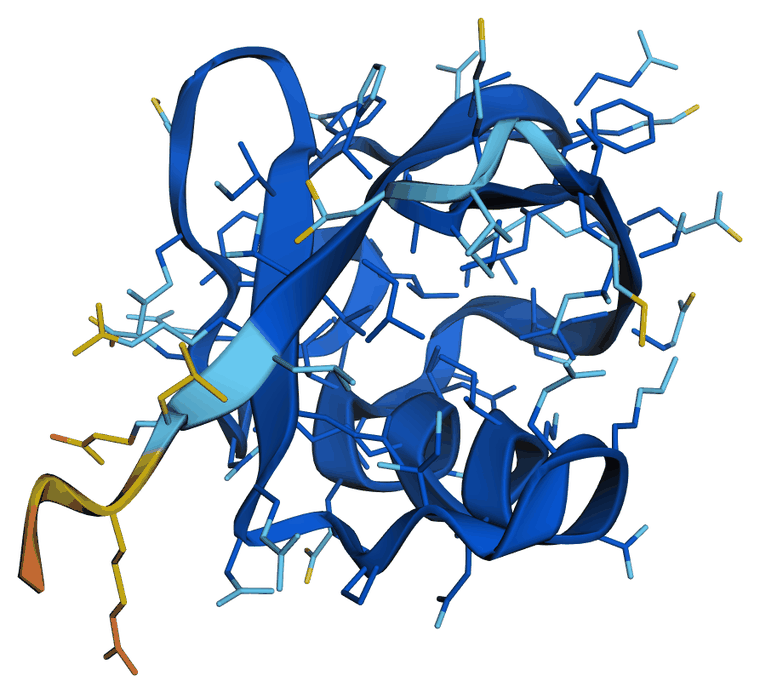
</p>

Coloured by [AlphaFold's four confidence bands](https://www.ebi.ac.uk/training/online/courses/alphafold/inputs-and-outputs/evaluating-alphafolds-predicted-structures-using-confidence-scores/plddt-understanding-local-confidence/):
dark blue ≥ 90 (very high), cyan 70–90 (confident), yellow 50–70 (low), orange < 50 (very low).

The β-grasp fold is dark blue throughout, while the C-terminal tail runs through yellow into
orange, with pLDDT falling to 43 at residue 76. That is the model correctly reporting that the tail
is flexible in isolation rather than failing to predict it. Low confidence is frequently the
right answer.

<details>
<summary>How this figure was made</summary>

`scripts/render_figure.py` in this repo does the whole job: superpose, render through
headless Chrome, then trim and scale to a size that belongs in a README.

Set it up once inside your `openfold-3` checkout, keeping the script, the references and the
output together in `figures/`. Anything scored against an experimental structure needs that
structure, and RCSB serves them under an uppercase id, so name the download with `-o`:

```bash
mkdir -p figures && cd figures
curl -O https://raw.githubusercontent.com/jianwen-xie/openfold3-quickstart/main/scripts/render_figure.py
curl -o 1ubq.cif https://files.rcsb.org/download/1UBQ.cif
cd ..
```

Then render, from the root of the `openfold-3` checkout:

```bash
pixi run -e openfold3-cuda12 python figures/render_figure.py plddt \
    quickstart_inference/ubiquitin/seed_42/ubiquitin_seed_42_sample_1_model.cif \
    figures/ubiquitin_cartoon.png --fit-to figures/1ubq.cif --rotate 60 --zoom 1.3 \
    --width 620 --canvas 1400x1100
```

Running it through `pixi run` is what supplies biotite. Chrome and ImageMagick are not in the
pixi environment; if either is missing the script says which one and stops. To install them,
`sudo apt install chromium-browser imagemagick` on Debian or Ubuntu, or
`brew install --cask google-chrome && brew install imagemagick` on macOS.

`--fit-to` renders the prediction **after superposing it on the reference**, so this figure and
the superposition below look at the molecule from the same angle. Rendering the raw file gives
the same colours in a different orientation, and the two figures become hard to compare.

The four bands come from a JavaScript colour callback rather than `py3Dmol`, which cannot pass
a function from Python; its nearest equivalent is a continuous rainbow ramp, which is a
different figure.

</details>

**Checking it against the experiment.** Ubiquitin has a well-known crystal structure
([1UBQ](https://www.rcsb.org/structure/1UBQ), 1.8 Å), so the prediction can be scored rather
than merely admired:

<p align="center">
  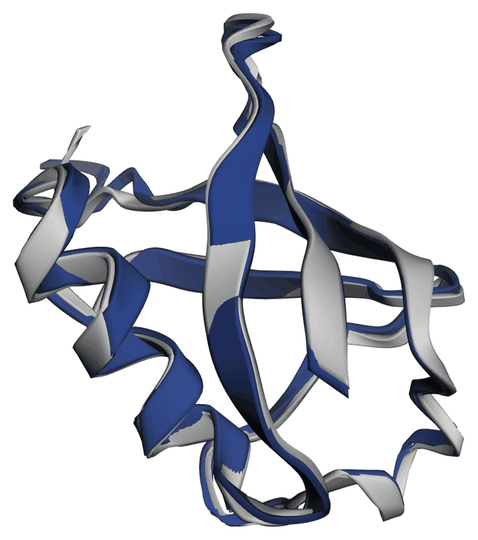
</p>

Prediction in navy, crystal structure in grey.

<details>
<summary>How this figure was made</summary>

```bash
pixi run -e openfold3-cuda12 python figures/render_figure.py super \
    quickstart_inference/ubiquitin/seed_42/ubiquitin_seed_42_sample_1_model.cif \
    figures/1ubq.cif figures/ubiquitin_vs_1ubq.png \
    --rotate 60 --zoom 1.3 --width 540 --canvas 1400x1100
```

`--rotate 60` is the same angle as the confidence figure above, so the two can be read
together.

</details>

| Superposition | Cα RMSD |
|---|---|
| All 76 residues | 0.73 Å |
| Residues 1–72, excluding the flexible tail | 0.44 Å |

Sub-ångström over the folded core, and the gap between the two rows is the C-terminal tail,
exactly the region pLDDT marked as uncertain. The confidence estimate predicted where the error
would be before any reference was consulted.

<details>
<summary>How these numbers were made</summary>

`score` reports the RMSD without rendering, so it needs neither Chrome nor ImageMagick:

```bash
pixi run -e openfold3-cuda12 python figures/render_figure.py score \
    quickstart_inference/ubiquitin/seed_42/ubiquitin_seed_42_sample_1_model.cif \
    figures/1ubq.cif --residues 1-72
```

```
  all matched atoms       0.73 A  over 76
  residues 1-72           0.44 A  over 72
```

`--residues` produces the second row: each range is superposed on its own, so it measures that
region's accuracy rather than its placement in the whole.

</details>

**Reading the numbers.** `plddt` is per-atom confidence from 0 to 100: above 90 is very high,
70 to 90 confident, below 50 usually disordered. `ptm` is the predicted TM-score for the whole
structure; `iptm` is its interface counterpart and is only meaningful for complexes (it reads
`0.0` for a single chain). `pae` is the predicted aligned error in angstroms: entry (i, j) is
how far off residue *i* is expected to be if you superimpose on residue *j*, which is what tells
you whether two domains are confidently placed relative to one another.

Timing per stage is written to `timing.json` in the same directory.

#### (2) A protein with a ligand

The simplest co-folding case: one protein and one small molecule. The repo ships an example,
named after the PDB entry it reproduces:

```bash
pixi run -e openfold3-cuda12 run_openfold predict \
    --query-json examples/example_inference_inputs/query_single_protein_single_ligand.json \
    --use-msa-server true \
    --output-dir ./quickstart_cofold
```

The query is T4 lysozyme L99A (164 residues) plus toluene, given as SMILES (`Cc1ccccc1`)
rather than a sequence. The reference is [7L39](https://www.rcsb.org/structure/7L39) at
1.35 Å, the classic model system for ligand binding in a buried hydrophobic cavity. The output
layout, the five samples and the ranking step are all as described above.

Confidence is not the interesting question here: lysozyme folds correctly either way, and
96.3% of atoms score ≥ 90. What matters is whether the ligand found the right pocket in the
right pose, so the figure to look at is the superposition:

<p align="center">
  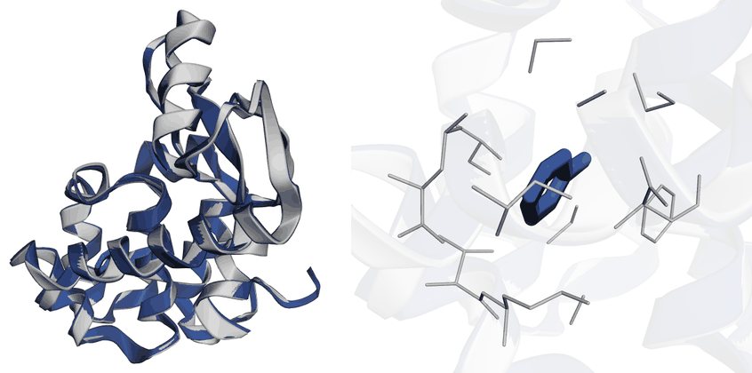
</p>

Prediction in navy, crystal structure in grey. **Left:** the whole complex. The binding
cavity is buried, so the ligand is only glimpsed through the fold. **Right:** the cavity
close up, with the protein translucent, where the **blue ring is the predicted ligand** and
the **black ring beneath it the crystallographic one**, among the side chains lining the
pocket.

<details>
<summary>How this figure was made</summary>

Two renders, side by side. The second uses `--focus`, which frames a bound ligand and draws
the protein translucent with the pocket's side chains around it:

```bash
curl -o figures/7l39.cif https://files.rcsb.org/download/7L39.cif

pixi run -e openfold3-cuda12 python figures/render_figure.py super \
    quickstart_cofold/pdb_7L39/seed_42/pdb_7L39_seed_42_sample_1_model.cif figures/7l39.cif \
    figures/lyso_left.png --ref-ligand MBN \
    --rotate 0 --zoom 1.2 --width 420 --canvas 1000x1000

pixi run -e openfold3-cuda12 python figures/render_figure.py super \
    quickstart_cofold/pdb_7L39/seed_42/pdb_7L39_seed_42_sample_1_model.cif figures/7l39.cif \
    figures/lyso_right.png --focus LIG0 --focus-ref MBN --zoom 0.62 --width 420 --canvas 1000x1000

convert \
    \( figures/lyso_left.png  -background white -gravity east -splice 110x0 \) \
    \( figures/lyso_right.png -background white -gravity west -splice 110x0 \) \
    -background white -gravity center +append \
    -resize 900x -colors 256 -strip figures/lysozyme_toluene.png
```

The crystal's ligand has to be named, as `--ref-ligand` or `--focus-ref`, because the two
files call the same molecule different things: `LIG0` in the prediction, `MBN` in the crystal.

Only the close-up is `--translucent`. It is the only way to see into a buried cavity, but it
washes out the navy against grey that makes the left panel readable.

</details>


| Superposition | Deviation |
|---|---|
| Protein Cα, 162 residues | 0.23 Å |
| Toluene centroid vs. crystallographic position | 0.33 Å |

The ligand found the right pocket in the right pose, to within a third of an ångström.

`iptm` is finally meaningful here, scoring 0.94 alongside `avg_plddt` 97.8 and `ptm` 0.98. It
read `0.0` for ubiquitin, where a single chain has no interface to score. For anything with
more than one component it is the number to watch, not `ptm`.

<details>
<summary>How these numbers were made</summary>

`avg_plddt`, `ptm` and `iptm` are read from the aggregated confidences file that inference
writes. The rest are measured:

```bash
pixi run -e openfold3-cuda12 python figures/render_figure.py score \
    quickstart_cofold/pdb_7L39/seed_42/pdb_7L39_seed_42_sample_1_model.cif figures/7l39.cif \
    --ref-ligand MBN --plddt
```

```
  all matched atoms       0.23 A  over 162
  ligand centroid         0.33 A  (LIG0 vs MBN)
  mean pLDDT              97.8  over 1312 atoms
     very high >=90    96.3%
     confident 70-90    3.6%
     low 50-70          0.1%
     very low <50       0.0%
```

The ligand distance is measured after the protein has been superposed, so it reports the
pose rather than the fold. `--plddt` reads the B-factor column, which is where OpenFold3
stores per-atom confidence.

</details>

#### (3) Co-folding a complex

The ligand case has a single protein chain. The harder version is several chains that have to
fold *and* find their arrangement with one another. The repo ships one:

```bash
pixi run -e openfold3-cuda12 run_openfold predict \
    --query-json examples/example_inference_inputs/query_multimer.json \
    --use-msa-server true \
    --output-dir ./quickstart_multimer
```

The query is phosphatidylserine decarboxylase from *E. coli*, reproducing
[7CNX](https://www.rcsb.org/structure/7CNX) at 2.63 Å. Two sequences, four chains: a
253-residue β subunit supplied as chains `A` and `C`, and a 42-residue α subunit as `B` and
`D`. The two come from a single precursor that cleaves itself in half, which the crystal's
numbering still records, with β running 1–253 and α picking up at 255.

<p align="center">
  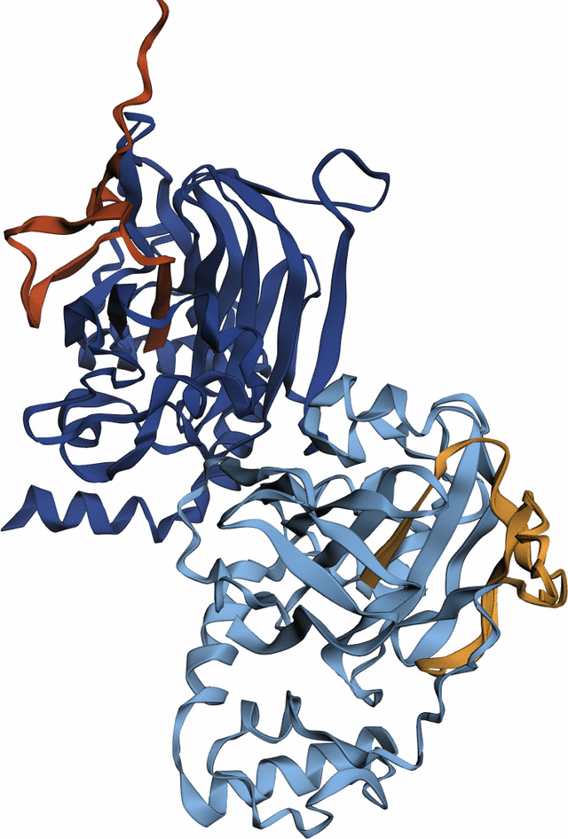
</p>

One colour per chain: β subunits in dark and light blue (`A`, `C`), α subunits in red and
orange (`B`, `D`). Each small α subunit packs against its own β partner, and the two αβ
heterodimers meet through a β–β interface in the middle. Getting this right means getting four
chains and three distinct interfaces right at once.

<details>
<summary>How this figure was made</summary>

```bash
curl -o figures/7cnx.cif https://files.rcsb.org/download/7CNX.cif

pixi run -e openfold3-cuda12 python figures/render_figure.py chains quickstart_multimer/7cnx/seed_42/7cnx_seed_42_sample_1_model.cif \
    figures/psd_chains.png --fit-to figures/7cnx.cif --ref-chains A,B,C,D \
    --rotate 20 --tilt 10 --zoom 1.10 --width 640 --canvas 1050x1200 \
    --colour 'A:#27408B' --colour 'C:#7FB2E5' --colour 'B:#C2461E' --colour 'D:#F0A33C'
```

The `--colour` pins give the two β subunits one hue and the two α subunits another, so each
pair reads as a pair rather than as four unrelated chains.

</details>

<p align="center">
  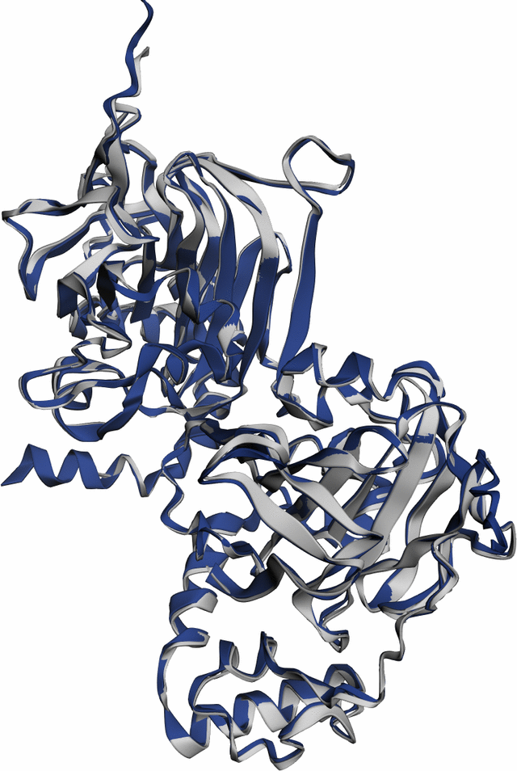
</p>

Prediction in navy, crystal structure in grey, same orientation as above. The colours no
longer identify chains as they did in the previous figure; here they separate the prediction
from the experiment.

<details>
<summary>How this figure was made</summary>

```bash
curl -o figures/7cnx.cif https://files.rcsb.org/download/7CNX.cif

pixi run -e openfold3-cuda12 python figures/render_figure.py super  quickstart_multimer/7cnx/seed_42/7cnx_seed_42_sample_1_model.cif \
    figures/7cnx.cif figures/psd_vs_7cnx.png --ref-chains A,B,C,D \
    --rotate 20 --tilt 10 --zoom 1.10 --width 640 --canvas 1050x1200
```

`--ref-chains A,B,C,D` picks the matching copy of the tetramer: 7CNX holds two in its
asymmetric unit. It reports 0.57 Å over 557 atoms, the first row of the table below.

</details>

| Superposition | Cα RMSD |
|---|---|
| All four chains at once, 557 residues | 0.57 Å |
| β subunit `A` alone, 246 residues | 0.29 Å |
| β subunit `C` alone, 240 residues | 0.35 Å |
| α subunit `B` alone, 38 residues | 1.11 Å |
| α subunit `D` alone, 33 residues | 0.20 Å |

The first row is the one that matters. Superposing all four chains together scores the folds
*and* their arrangement at the same time, so 0.57 Å means the assembly is right, not merely
four chains that are each correct but wrongly placed. The navy helix on the left with no grey
beneath it is a stretch the crystal never resolved; the reference chain starts at residue 8.

**Reading `chain_pair_iptm`.** Overall the run scores `avg_plddt` 92.8, `ptm` 0.90, `iptm` 0.89
and no clashes. But the aggregated file also scores every *pair* of chains separately, and this
is where a complex tells you more than any single number can:

| | measured closest approach | `chain_pair_iptm` |
|---|---|---|
| `(A, B)` and `(C, D)`, α against its own β | 2.7 Å | 0.96 |
| `(A, C)`, the β–β interface | 2.6 Å | 0.85 |
| `(A, D)` and `(B, C)`, across the assembly | 11.4 Å | 0.78 |
| `(B, D)`, the two α subunits | 27.1 Å | 0.54 |

<details>
<summary>How these numbers were made</summary>

The `chain_pair_iptm` column is read straight out of the inference output, no computation
needed:

```bash
python3 -c "
import json
d = json.load(open('quickstart_multimer/7cnx/seed_42/7cnx_seed_42_sample_1_confidences_aggregated.json'))
print(d['chain_pair_iptm'])"
```

The RMSDs and the distances are measured against the crystal structure:

```bash
pixi run -e openfold3-cuda12 python figures/render_figure.py score \
    quickstart_multimer/7cnx/seed_42/7cnx_seed_42_sample_1_model.cif figures/7cnx.cif \
    --ref-chains A,B,C,D --per-chain --contacts
```

```
  all matched atoms       0.57 A  over 557
  chain A alone          0.29 A  over 246
  chain B alone          1.11 A  over 38
  chain C alone          0.35 A  over 240
  chain D alone          0.20 A  over 33
  closest approach between chains:
     (A, B)   2.72 A     (A, C)   2.65 A     (A, D)  11.42 A
     (B, C)  11.34 A     (B, D)  27.08 A     (C, D)   2.72 A
```

`--per-chain` superposes each chain on its own, so those rows measure a chain's fold rather
than its placement in the assembly. `--contacts` is what makes the next paragraph checkable:
without it you cannot tell a badly modelled interface from one that is not there.

</details>

The low score is the interesting one, and it is not a warning. `(B, D)` reads 0.54 because
those two chains sit 27 Å apart and never touch. The metric is scoring an interface that does
not exist. A low `chain_pair_iptm` means *this pair is not confidently placed relative to each
other*, which for a non-contacting pair is both true and harmless. Check it against the
geometry before treating it as a failure.

### Across multiple GPUs

*To follow.* OpenFold3 distributes a multi-query job across GPUs, parallel across queries
rather than within a single structure. See the upstream
[inference docs](https://openfold-3.readthedocs.io/en/latest/inference.html#inference-run-on-multiple-gpus)
in the meantime.

## Training

### Prepare the training data

Generate a subset of the PDB training data:

```bash
# --train-size  how many training structures to sample
# --seed        fixes which ones, so the subset is reproducible
pixi run -e openfold3-cuda12 generate-pdb-subset --train-size 8 --seed 42
```

Download the corresponding data:

```bash
# --train-size  must match the line above; each command finds its cache by this number
# --workers     parallel download threads (default 8)
# ends on "1 failed": one validation template is absent from the bucket, which is harmless
pixi run -e openfold3-cuda12 download-pdb-subset --train-size 8 --workers 24
```

The dataset configuration for training is written to `datasets/train_pdb_subset.yaml`, and the
default `max_epochs` is 2. The 1.6 GB catalogue the first command fetches is a listing of the
whole PDB training set rather than training data, and can be deleted once the subset caches
exist.

### Scheme 1: single GPU, H100

Log in to Weights & Biases once, so the run can stream its losses to a dashboard:

```bash
pixi run -e openfold3-cuda12 wandb login
```

The generated config logs nothing, so every loss it computes is discarded. Copy it and turn
logging on. Copy rather than edit in place: the file's first line reads
`# Auto-generated by generate_subset_cache.py -- do not edit by hand`, and re-running the
generator would overwrite it.

```bash
cp datasets/train_pdb_subset.yaml datasets/quickstart_single_h100.yaml
```

Then change three values in the copy:

```yaml
experiment_settings:
  output_dir: ./quickstart_run     # was ./test_train_output, renamed to match this guide

logging_config:
  log_lr: true                     # was false
  wandb_config:                    # was null, which is what discards the losses
    project: openfold3-quickstart
    experiment_name: single-h100
```

<details>
<summary>The same three edits as a command</summary>

```bash
pixi run -e openfold3-cuda12 python -c "
import yaml

# read the config generate-pdb-subset wrote
c = yaml.safe_load(open('datasets/train_pdb_subset.yaml'))

# it ships with wandb_config: null, which is why losses are computed and thrown away
c['logging_config'] = {'log_lr': True, 'wandb_config': {
    'project': 'openfold3-quickstart', 'experiment_name': 'single-h100'}}

# checkpoints and metrics land here
c['experiment_settings']['output_dir'] = './quickstart_run'

# write a NEW file; train_pdb_subset.yaml is left exactly as generated
yaml.safe_dump(c, open('datasets/quickstart_single_h100.yaml', 'w'), sort_keys=False)"
```

`yaml.safe_dump` rewrites the file in its own style, so comments and key order from the
generated config are not preserved. The values are the same either way.

</details>

Train:

```bash
# --runner-yaml points at the file written just above, not at train_pdb_subset.yaml
pixi run -e openfold3-cuda12 run_openfold train \
    --runner-yaml datasets/quickstart_single_h100.yaml --seed 42
```

Two epochs of four steps, a few minutes. The curve appears in your wandb project and updates
as it trains. To run without an account, see [Without a wandb account](#without-a-wandb-account).

Output goes to the `output_dir` set in the config:

```
quickstart_run/
├── openfold3-quickstart/<run id>/checkpoints/
│   └── last.ckpt                   the model, ~6 GB
├── wandb/<run dir>/
│   ├── run-<run id>.wandb          the metrics, binary
│   └── files/                      resolved configs, package versions
└── logs/                           always empty
```

Two traps in that layout. Enabling logging **moves the checkpoint** out of
`quickstart_run/checkpoints/`, so hardcoded paths break. And `logs/` is always empty, whichever
logging mode you use.

### Scheme 2: multiple GPUs, one node

*To follow.* Set `pl_trainer_args.devices: 8`; the launch command is unchanged.

### Scheme 3: multiple nodes, Slurm

*To follow.* Set `pl_trainer_args.num_nodes: N` and submit with `sbatch`. Submission scripts
will live in `slurm/`.

### Monitoring the training curve

With logging on, the run streams to your wandb project and the curve updates while it trains.
That is the whole of the default path: open the project page.

Eight steps is too few to plot, so the figure below is the same pipeline run longer:
`epoch_len: 25` and `max_epochs: 6`, which is 150 steps and about 25 minutes on one H100.

<p align="center">
  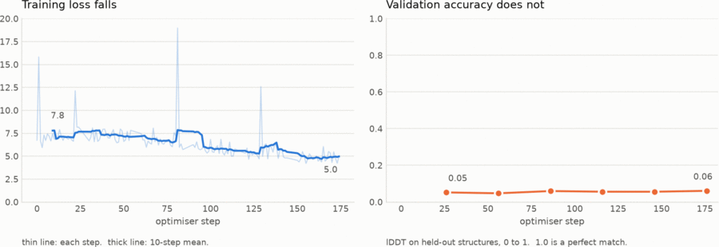
</p>

| | start | end |
|---|---:|---:|
| `train/loss` | 6.74 | 4.96 |
| `val/lddt_intra_protein` | 0.052 | 0.061 |
| `val/rmsd` | 20.96 Å | 20.30 Å |

**The loss falls and it means nothing.** It drops by a quarter while accuracy on the four
held-out structures does not move: lDDT stays near 0.05 where 1.0 is perfect, and RMSD sits
above 20 Å. The model is fitting eight structures, not learning to fold. Read this curve as a
pipeline check, not as progress.

<details>
<summary>Why it cannot do better, and how the figure was made</summary>

**Training starts from random weights.** `restart_checkpoint_path: last` finds no checkpoint on
a first run, and Lightning logs `no last checkpoint available. No checkpoint will be loaded`.
It does not fall back to the released parameters that inference uses, so this is a fresh model,
which is why its predictions sit ~20 Å from the answer. The quickstart trains a new model
badly; it does not fine-tune a good one. That, and eight structures being far too few to
generalise from, is the whole story. For a curve that means something, see
[Training on the full dataset](#training-on-the-full-dataset).

The spikes to 12 to 19 are single steps rather than instability: batch size is one structure,
and a large or awkward crop costs much more loss than a small one.

To plot, keep the extraction above as a list of records instead of writing the CSV. Its
`if 'train/loss' in row` filter drops every validation record: this run logs 18 of them, and
not one carries that key.

```python
import numpy as np, matplotlib
matplotlib.use("Agg")
import matplotlib.pyplot as plt

def series(key):                      # rows: every history record, in order
    pts = sorted((r["_step"], r[key]) for r in rows
                 if key in r and "_step" in r and isinstance(r[key], (int, float)))
    return np.array([p[0] for p in pts]), np.array([p[1] for p in pts])

ts, tv = series("train/loss")                   # 150 points, one per step
vs, vv = series("val/lddt_intra_protein")       # 6 points, one per epoch

fig, (ax1, ax2) = plt.subplots(1, 2, figsize=(11, 4.1), dpi=150)
ax1.plot(ts, tv, color="#2a78d6", linewidth=1.0, alpha=0.28)
w = 10                                          # 10-step running mean
ax1.plot(ts[w - 1:], np.convolve(tv, np.ones(w) / w, mode="valid"),
         color="#2a78d6", linewidth=2.0)
ax2.plot(vs, vv, color="#eb6834", linewidth=2.0, marker="o", markersize=8,
         markeredgecolor="#fcfcfb", markeredgewidth=2)
ax1.set_ylim(0, 20)
ax2.set_ylim(0, 1)                              # full lDDT range, not zoomed
ax2.set_xlim(ax1.get_xlim())                    # same step axis on both panels
```

Two panels rather than twin y-axes: a loss of ~5 and an lDDT of ~0.05 share no scale, and
overlaying them lets the crossing point be moved anywhere by choosing the limits. The lDDT
panel is drawn over its full 0 to 1 range for the same reason; zoomed to 0.05 to 0.06 those
six points look like a healthy climb.

</details>

#### Without a wandb account

Everything above assumes a dashboard. The run also works fully offline, at the cost of two
extra steps and a script to read the result back.

Add one line to the `wandb_config` block in the copy:

```yaml
logging_config:
  log_lr: true
  wandb_config:
    project: openfold3-quickstart
    experiment_name: single-h100
    offline: true                  # add this
```

That is not sufficient on its own. `WANDB_MODE=offline` has to be in the environment too,
because the YAML flag does not stop `wandb.init` attempting a login, and the run dies before
training starts:

```bash
WANDB_MODE=offline pixi run -e openfold3-cuda12 run_openfold train \
    --runner-yaml datasets/quickstart_single_h100.yaml --seed 42
```

There is no dashboard, and `logs/` stays empty. The metrics live in a binary `.wandb` file, so
reading the curve means decoding it:

```bash
pixi run -e openfold3-cuda12 python -c "
import csv, glob, json
from wandb.proto import wandb_internal_pb2 as pb
from wandb.sdk.internal import datastore

store = datastore.DataStore()
store.open_for_scan(glob.glob('quickstart_run/wandb/offline-run-*/run-*.wandb')[0])
rows = []
while True:
    data = store.scan_data()
    if data is None: break
    rec = pb.Record(); rec.ParseFromString(data)
    if rec.WhichOneof('record_type') != 'history': continue
    row = {i.key or '.'.join(i.nested_key): json.loads(i.value_json) for i in rec.history.item}
    if 'train/loss' in row: rows.append(row)

cols = ['_step', 'train/loss', 'train/distogram_loss', 'train/diffusion_loss']
with open('quickstart_run/metrics.csv', 'w', newline='') as f:
    w = csv.DictWriter(f, fieldnames=cols, extrasaction='ignore'); w.writeheader(); w.writerows(rows)
print(f'{len(rows)} steps -> quickstart_run/metrics.csv')"
```

```bash
column -s, -t quickstart_run/metrics.csv
```

The notebook takes this path, so it runs without credentials, and prints the result as a table.

A finished offline run can also be uploaded afterwards, which gets the dashboard back:

```bash
pixi run -e openfold3-cuda12 wandb sync quickstart_run/wandb/offline-run-*
```

### Running longer

The default is deliberately short: two epochs of four steps, enough to prove the pipeline.
Eight points is not a curve. To get a trace worth monitoring, raise these in the config:

| Setting | Default here | For a longer run |
|---|---|---|
| `data_module_args.epoch_len` | `4` | `50`+, steps per epoch |
| `pl_trainer_args.max_epochs` | `2` | `10`+ |
| `--train-size` on `generate-pdb-subset` | `8` | more structures to sample from |

More structures means re-running both setup commands with the new size, not just the first:

```bash
pixi run -e openfold3-cuda12 generate-pdb-subset --train-size 32
pixi run -e openfold3-cuda12 download-pdb-subset --train-size 32
```

At roughly 8 to 10 s per step on one H100, 150 steps is about 20 minutes plus validation
between epochs. Each new size is a fresh download, so check free disk first: 8 structures take
73 MB, and it scales roughly with the count.

### Training on the full dataset

The subset above exists so the pipeline can be proven quickly. Real training swaps it for the
full PDB set and starts from one of the configs in `examples/training_yamls/`
(`initial_training.yml` through `finetune_3.yml`), which carry real schedules rather than a
two-epoch smoke test.

```bash
aws s3 sync s3://openfold3-data/pdb_training_set/ /shared/openfold3/pdb_training_set/ --no-sign-request
```

## Running the notebook instead

The notebook runs all of the above and keeps the output. Most of its cells are these same
shell commands; two are Python analysis, and one imports `wandb`, so the pixi environment is
the most convenient kernel:

```bash
pixi run -e openfold3-cuda12 python -m pip install ipykernel
pixi run -e openfold3-cuda12 python -m ipykernel install --user \
    --name openfold3-cuda12 --display-name "OpenFold3 (pixi cuda12)"
```

Then edit the `%cd` in its first cell to point at your checkout.

## Links

- OpenFold3: <https://github.com/aqlaboratory/openfold-3>
- Training guide: <https://openfold-3.readthedocs.io/en/latest/training.html>
- Configuration reference: <https://openfold-3.readthedocs.io/en/latest/configuration_reference.html>
- Datasets: <https://portal.openfold.omsf.io/datasets>

## More inference demos

Two further examples, kept separate from the quickstart above. Both run on one GPU in well
under a minute and both are scored against a crystal structure. Each exercises a capability
the three worked examples do not.

### Three different proteins at once

MHC class I: a heavy chain, β2-microglobulin and a nine-residue antigen peptide, three
separate molecules with nothing in common, assembling into one complex. The quickstart's
co-folding example is four chains but only two distinct sequences; this is three.

The query is three `protein` chains, built from [1DUZ](https://www.rcsb.org/structure/1DUZ),
HLA-A2 presenting the HTLV-1 Tax peptide `LLFGYPVYV`:

```bash
# three chains: A heavy chain (275 res), B beta2-microglobulin (100), C peptide (9)
pixi run -e openfold3-cuda12 run_openfold predict \
    --query-json queries/query_mhc.json \
    --use-msa-server true \
    --output-dir ./demo_mhc
```

<p align="center">
  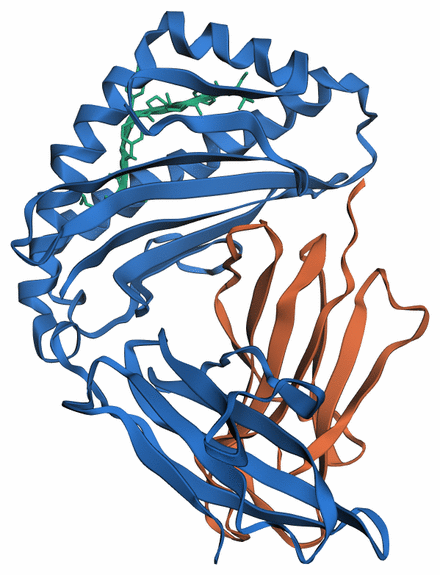
</p>

One colour per protein: the **heavy chain in blue**, **β2-microglobulin in orange**, the
**peptide in green**. The architecture comes out right, with the peptide clamped in the groove
formed by the heavy chain's two long helices and β2-microglobulin tucked underneath as the
support subunit.

<details>
<summary>How this figure was made</summary>

```bash
curl -o figures/1duz.cif https://files.rcsb.org/download/1DUZ.cif

pixi run -e openfold3-cuda12 python figures/render_figure.py chains \
    demo_mhc/mhc_class_i/seed_42/mhc_class_i_seed_42_sample_1_model.cif \
    figures/demo_mhc_chains.png --fit-to figures/1duz.cif --ref-chains D,E,F \
    --rotate 70 --zoom 0.98 --sticks C --width 440 --canvas 1200x1000
```

`--sticks C` is needed because a nine-residue chain has no secondary structure for a cartoon
to trace, and would otherwise not be drawn at all.

</details>

<p align="center">
  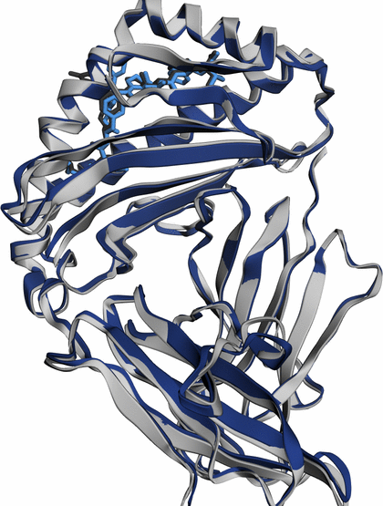
</p>

**The colours change meaning between these two figures.** Above, a colour identifies the
molecule. Here it identifies the structure: everything predicted is blue, everything from the
1DUZ crystal is grey.

<details>
<summary>How this figure was made</summary>

```bash
curl -o figures/1duz.cif https://files.rcsb.org/download/1DUZ.cif

pixi run -e openfold3-cuda12 python figures/render_figure.py super \
    demo_mhc/mhc_class_i/seed_42/mhc_class_i_seed_42_sample_1_model.cif figures/1duz.cif \
    figures/demo_mhc_vs_1duz.png --rotate 70 --zoom 0.98 \
    --sticks C --ref-sticks F --ref-chains D,E,F --width 420
```

`--ref-chains D,E,F` picks which copy of the complex to score against and drops the other
from the picture. 1DUZ holds two; without the flag the prediction aligns to whichever shares
its chain ids, the second is drawn unaligned in the corner, and the RMSD reads 0.63 Å rather
than 0.67 Å.

</details>

Both peptides are in the groove, one inside the other. The crystal's is drawn as thick dark
sticks and the predicted one as thinner pale blue sticks on top, because at this accuracy the
prediction otherwise hides the crystal completely and the figure looks as though only one
peptide were there. Measured in the frame of the whole complex, that is 0.55 Å mean per
residue and 0.96 Å at worst:

```
residue   1     2     3     4     5     6     7     8     9
dev (Å) 0.25  0.47  0.51  0.84  0.96  0.45  0.57  0.48  0.38
```

The 0.26 Å in the table is the peptide superposed on its own, which measures only its shape.
The numbers here keep the assembly's frame, so they measure shape and placement together.

Both are sticks rather than ribbon because a nine-residue chain has no secondary structure for
a cartoon to trace, and 3Dmol draws nothing at all for it.

| Superposition | Cα RMSD | mean pLDDT | `chain_ptm` |
|---|---|---|---|
| Heavy chain, 275 residues | 0.74 Å | 98.1 | 0.963 |
| β2-microglobulin, 100 residues | 0.30 Å | 98.4 | 0.973 |
| Peptide, 9 residues | 0.26 Å | 94.3 | **0.165** |
| All three at once, 384 residues | **0.67 Å** | | |

`avg_plddt` 95.8, `ptm` 0.98, `iptm` 0.98, no clashes. Every pairwise interface scores high:
`(A, B)` 0.98, `(A, C)` 0.97, `(B, C)` 0.89. Superposing all three chains together gives
0.67 Å, so the assembly is right and not just the parts.

**One number in that table is lying.** The peptide scores `chain_ptm` 0.165, which reads like
a failure, while its pLDDT is 94.3 and it is placed to 0.26 Å. pTM is a length-normalised
score, and over nine residues the normalisation makes it pessimistic no matter how good the
prediction is. For a chain this short, read `chain_pair_iptm` instead, which puts the
peptide's interface with the heavy chain at 0.97.

Compare the MDM2 demo below, where the peptide also scores a low `chain_ptm`, 0.07. There the
pLDDT is 56 and the model really is unsure. Here it is 94.3. A low `chain_ptm` on a short
chain means nothing on its own; what distinguishes the two cases is pLDDT.

### A protein bound to DNA

Zif268, three zinc fingers wrapped around their DNA site, reproducing
[1AAY](https://www.rcsb.org/structure/1AAY). Three molecule types in one query: an 85-residue
protein, an 11 bp DNA duplex given as two `dna` chains, and the three structural Zn²⁺ ions the
fingers fold around, given by CCD code.

```bash
# 6 chains: A protein, B and C the two DNA strands, D/E/F one Zn each
pixi run -e openfold3-cuda12 run_openfold predict \
    --query-json queries/query_zif268_dna.json \
    --use-msa-server true \
    --output-dir ./demo_zif
```

<p align="center">
  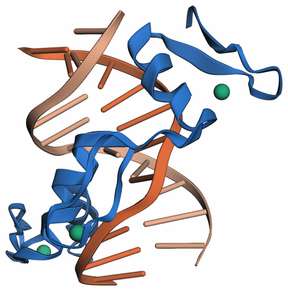
</p>

One colour per component: the **protein in blue**, the **two DNA strands in dark and light
orange**, sharing a hue because they are one duplex, and the **three zinc ions as green
spheres**. Each finger sits in the major groove and carries its own zinc.

<details>
<summary>How this figure was made</summary>

```bash
curl -o figures/1aay.cif https://files.rcsb.org/download/1AAY.cif

pixi run -e openfold3-cuda12 python figures/render_figure.py chains \
    demo_zif/zif268_dna/seed_42/zif268_dna_seed_42_sample_1_model.cif \
    figures/demo_zif_chains.png --fit-to figures/1aay.cif \
    --rotate 60 --zoom 0.98 --spheres ZN --width 470 \
    --colour 'B:#eb6834' --colour 'C:#f6b08c' --colour 'ZN:#1baf7a'
```

The `--colour` pins give the two DNA strands one hue, so they read as a duplex rather than as
two unrelated chains, which is what the default palette would do.

</details>

<p align="center">
  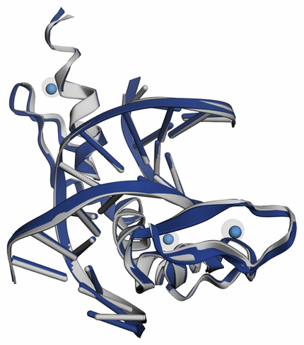
</p>

Prediction in navy, 1AAY crystal structure in grey; colours here separate prediction from
experiment, not component from component. The crystal's zinc ions are drawn as large
translucent spheres with the predicted ones solid inside them.

<details>
<summary>How this figure was made</summary>

```bash
curl -o figures/1aay.cif https://files.rcsb.org/download/1AAY.cif

pixi run -e openfold3-cuda12 python figures/render_figure.py super \
    demo_zif/zif268_dna/seed_42/zif268_dna_seed_42_sample_1_model.cif figures/1aay.cif \
    figures/demo_zif_vs_1aay.png --rotate 60 --zoom 0.98 --spheres ZN \
    --width 430 --canvas 1250x1000
```

`--spheres ZN` draws the crystal's ions large and translucent with the predicted ones solid
inside, because an opaque sphere hides an ion sitting a quarter of an ångström within it.

</details>

| Superposition | RMSD |
|---|---|
| Protein alone, 85 Cα | 0.46 Å |
| DNA alone, 22 C1' | 0.34 Å |
| Protein and DNA together, 107 atoms | **0.44 Å** |
| Each Zn²⁺ to its crystal position | 0.23, 0.26, 0.49 Å |

`avg_plddt` 95.6, `ptm` 0.94, `iptm` 0.95, no clashes, 12 s on one H100. Superposing protein
and DNA in one go gives 0.44 Å, so the protein is not merely folded correctly but placed
correctly on the duplex, and each zinc lands within half an ångström of its crystallographic
site.

**Reading per-chain scores on a mixed complex.** The pairwise numbers behave, up to a point:

| | `chain_pair_iptm` |
|---|---|
| protein to each zinc | 0.99 |
| protein to each DNA strand | 0.95 |
| DNA strand to DNA strand | **0.50** |
| zinc to zinc | **0.00** |

The zinc-to-zinc zeros are the familiar case from the co-folding example above: three ions far
apart with no interface, so there is nothing for the score to measure. The DNA pair is the one
that misleads. The two strands are base paired, 2.64 Å apart at closest approach with ten of
their N1 and N3 atoms inside hydrogen-bonding range, and the duplex matches the crystal to
0.34 Å. It still scores 0.50.

`chain_ptm` is worse here and should simply be ignored: 0.93 for the protein, 0.17 and 0.15
for the DNA strands, and exactly 0.00 for each zinc. A single atom has no fold to score. As
with the MHC peptide above, these are artefacts of chain length, not statements about
accuracy.

### A cyclic peptide bound to MDM2

A macrocyclic peptide inhibitor against the p53-binding domain of MDM2, a long-standing cancer
target. The query marks the 10-residue chain `cyclic: true`, which asks for a closed
macrocycle rather than a linear peptide:

```bash
pixi run -e openfold3-cuda12 run_openfold predict \
    --query-json examples/example_inference_inputs/query_multimer_cyclic.json \
    --use-msa-server true \
    --output-dir ./demo_mdm2
```

<p align="center">
  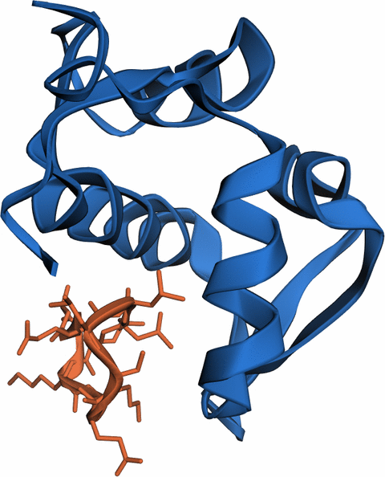
</p>

The predicted complex, one colour per chain: **MDM2 in blue**, the **cyclic peptide in
orange**. The peptide lies across the shallow groove on the near face, which is where p53
binds.

<details>
<summary>How this figure was made</summary>

```bash
curl -o figures/1ycr.cif https://files.rcsb.org/download/1YCR.cif

pixi run -e openfold3-cuda12 python figures/render_figure.py chains \
    demo_mdm2/mdm2/seed_42/mdm2_seed_42_sample_1_model.cif \
    figures/demo_mdm2_chains.png --fit-to figures/1ycr.cif \
    --rotate 45 --zoom 1.30 --sticks B --width 480 --canvas 1100x950
```

`--sticks B` draws the ten-residue cyclic peptide, which is too short for a cartoon to trace.

</details>

Superposed on the crystal structure:

<p align="center">
  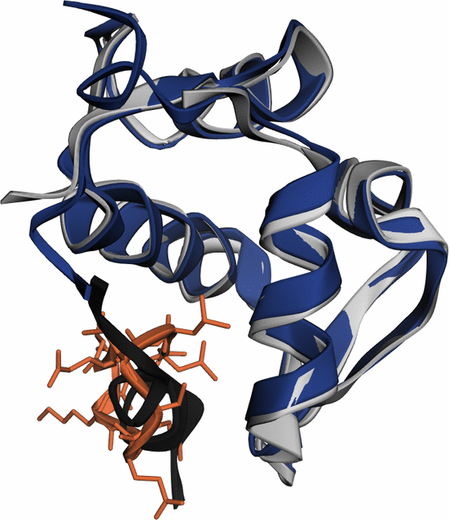
</p>

Prediction in navy with its cyclic peptide in orange, the
[1YCR](https://www.rcsb.org/structure/1YCR) crystal structure in grey with its p53 peptide in
black.

| | |
|---|---|
| MDM2 domain Cα RMSD vs 1YCR | 0.59 Å over 85 residues |
| Peptide centroid vs the p53 peptide in 1YCR | 4.16 Å |
| Peptide closest approach to MDM2 | 2.42 Å |
| Peptide N-terminus to C-terminus | 1.39 Å |
| `avg_plddt` / `ptm` / `iptm` | 84.3 / 0.85 / 0.40 |
| `chain_ptm` A (protein) / B (peptide) | 0.90 / 0.07 |

Two things to take from this one.

The cyclic request was honoured. The distance from the peptide's first backbone nitrogen to
its last backbone carbon is 1.39 Å, which is a peptide bond, so the chain really is closed
head to tail rather than drawn as a linear decamer that happens to curl round.

And the model is openly unsure where it sits. The domain is near-exact at 0.59 Å and scores
`chain_ptm` 0.90, while the peptide scores 0.07 and a mean pLDDT of 56. It does land in the
p53 groove, in contact at 2.42 Å and with its centroid 4.2 Å from where p53 sits, but the
confidence says do not trust the pose to better than that. For a designed macrocycle with no
natural homologue, that is the honest answer.

### Steering a ligand with a pocket constraint

TEM-1 β-lactamase with FTA, a core-disrupting allosteric inhibitor, reproducing
[1PZP](https://www.rcsb.org/structure/1PZP). The query carries a `pocket_constraint` naming
eight residues the ligand should sit against:

```bash
pixi run -e openfold3-cuda12 run_openfold predict \
    --query-json examples/example_inference_inputs/query_protein_ligand_pocket_constraint.json \
    --use-msa-server true \
    --output-dir ./demo_bla
```

<p align="center">
  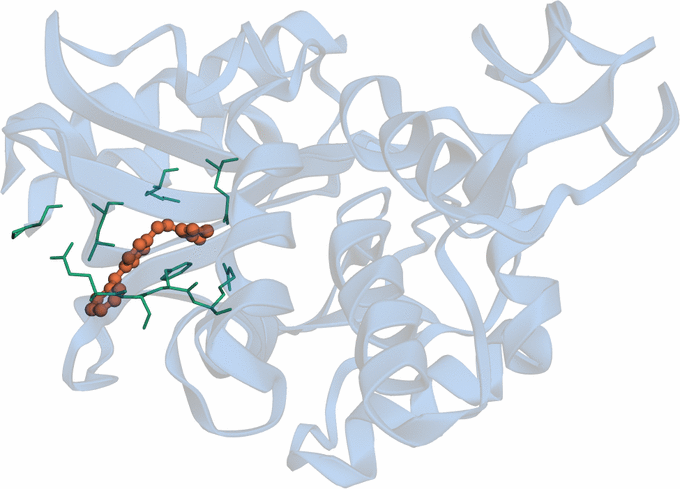
</p>

The predicted complex, one colour per component: the **protein in blue**, drawn translucent
because the site is buried, the **ligand in orange**, and the **eight residues named in the
constraint in green**. The ligand sits among them, which is what the constraint asked for.

<details>
<summary>How this figure was made</summary>

```bash
curl -o figures/1pzp.cif https://files.rcsb.org/download/1PZP.cif

pixi run -e openfold3-cuda12 python figures/render_figure.py chains \
    demo_bla/bla_1PZP_FTA/seed_42/bla_1PZP_FTA_seed_42_sample_1_model.cif \
    figures/demo_bla_chains.png --fit-to figures/1pzp.cif \
    --rotate 60 --zoom 1.30 --translucent \
    --highlight 2,5,9,12,33,34,35,36 --colour 'LIG0:#eb6834' \
    --width 680 --canvas 1200x980
```

`--translucent` drops the cartoon's opacity, without which the buried ligand is hidden
entirely. `--highlight` draws the eight residues the constraint names, so the constraint
itself is visible and not only its effect.

</details>

To see what that buys, the same query was run again with the `pocket_constraint` block deleted
and nothing else changed.

<p align="center">
  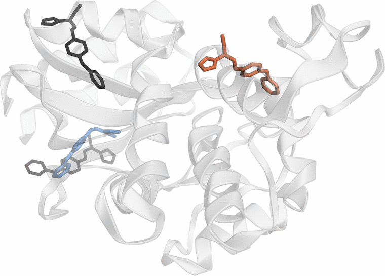
</p>

**The colours mean something different from the figure above.** There they identified the
components; here they identify which run a ligand came from. The protein is drawn once, from
the crystal, in grey, with both of its FTA copies in near-black. **Blue is the ligand the
constrained run placed**, sitting on one of them. **Orange is the ligand the unconstrained run
placed**, 19 Å away. So blue, which was the protein above, is now the right answer, and
orange, which was the ligand above, is now the wrong one.

| | with the constraint | without it |
|---|---|---|
| Protein Cα RMSD vs 1PZP | 1.03 Å | 1.01 Å |
| Ligand centroid vs crystal FTA | **3.44 Å** | **22.39 Å** |
| Ligand closest approach to the eight named residues | 2.05 Å | 19.15 Å |
| `iptm` | 0.607 | **0.859** |

The constraint moves the ligand 19 Å and leaves the protein alone, which is what it is for.
Dropping it does not produce a random pose either: the unconstrained ligand packs against
S70, S130, N132 and K234, which is the catalytic active site. That is the obvious place to put
a ligand on a β-lactamase, and it is the wrong one here, because FTA works allosterically.

The `iptm` column is the part worth remembering. The wrong answer scores **0.859** and the
right one **0.607**. Confidence is not accuracy, and on ligand placement it can point
confidently at the textbook site while the real one sits 19 Å away. A pocket constraint is how
you supply what the model cannot infer.

<details>
<summary>How the numbers and figures were produced</summary>

All four are scored the same way: superpose on the reference protein, carry that one transform
to every other component, then measure. What differs between them is how the residues get
matched up in the first place, and each one has its own trap.

**Match by identity, not by overlap.** The MDM2 prediction numbers its chain 1 to 92 while
1YCR numbers the same domain 25 to 109. Choosing the offset that maximises how many residue
ids happen to overlap picks 17 and reports 10.10 Å. Choosing the one that maximises identical
residue *names* picks 22, matches 85 of 85, and reports 0.59 Å. The first is an alignment
error wearing the costume of a prediction error.

```python
cand = []
for o in range(-60, 61):
    ids = [i for i in pred_names if i + o in ref_names]
    if len(ids) < 30: continue
    cand.append((sum(pred_names[i] == ref_names[i + o] for i in ids) / len(ids), o))
offset = max(cand)[1]          # -> 22, at 100% identity
```

**No single offset works across a whole structure.** Each demo needs its own, and MHC needs
one per chain:

| | offset to its reference |
|---|---|
| MHC heavy chain / β2m / peptide | 0 / **-1** / 0 |
| Zif268 protein, 1 to 85 against 1AAY's 103 to 187 | 102 |
| β-lactamase, 1-based against 1PZP's Ambler numbering | 25 |
| MDM2 domain against 1YCR | 22 |
| PSD β subunits `A`, `C` / α subunits `B`, `D` | 0 / **253** |

β2-microglobulin's `-1` is the kind of thing that is invisible until it is wrong: match on
residue id alone and every residue shifts by one, which still superposes and still returns a
plausible number.

**DNA cannot be matched on residue id at all.** 1AAY numbers its two strands 1 to 11 and 51 to
61; the prediction numbers both 1 to 11. Matching on id would silently drop the second strand
entirely and leave you scoring half a duplex. They are paired by order along each strand
instead, on C1', which is safe only because both strands have the same length and the same
5' to 3' sense:

```python
def strand(arr, ch):
    s = arr[(arr.chain_id == ch) & (arr.atom_name == "C1'")]
    return s.coord[np.argsort(s.res_id)]
```

**Decoding the pocket constraint.** The β-lactamase offset of 25 also translates the
constraint: `pocket_residues` `[2, 5, 9, 12, 33, 34, 35, 36]` becomes `[27, 30, 34, 37, 58,
59, 60, 61]`, which are the first eight of the 24 residues within 5 Å of FTA in the crystal.
The constraint was read off the reference structure.

**Two figure traps, both of which hide the component the example is about.** A nine-residue
peptide has no secondary structure for a cartoon to trace, so 3Dmol draws nothing at all for
it and the MHC superposition appeared to contain two chains rather than three; both peptides
are sticks for that reason. And a predicted ion sitting a quarter of an ångström inside an
opaque crystal sphere is invisible, so in the Zif268 superposition the crystal's zincs are
large and translucent with the predicted ones solid inside. In both cases the first render
looked like a missing component when it was really an accurate one.

1PZP contains two copies of FTA, 17.9 Å apart. The centroid distances quoted are to the nearer
copy, and both copies appear in the figure.

Two figures are not reproducible from the script: the three-structure β-lactamase overlay, and
the MDM2 superposition, which keeps the peptide's own colour instead of folding it into the
prediction colour and scores the domain alone rather than the complex. Their code stays inline
in the sections above.

</details>

## License

Apache-2.0. See [LICENSE](LICENSE).

